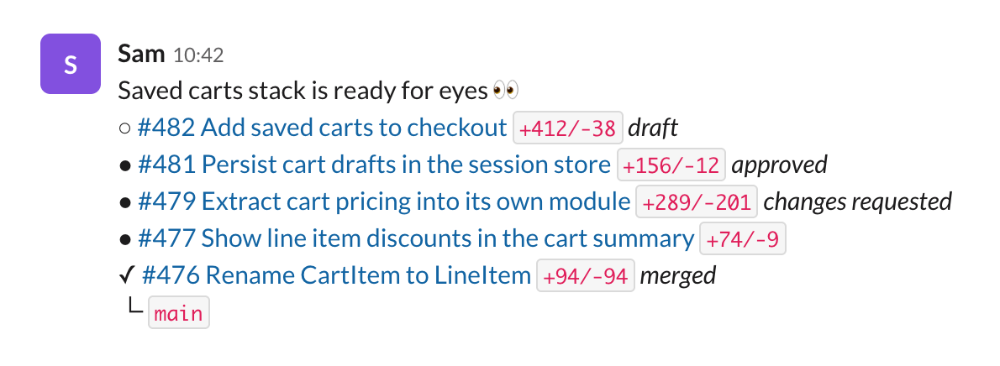
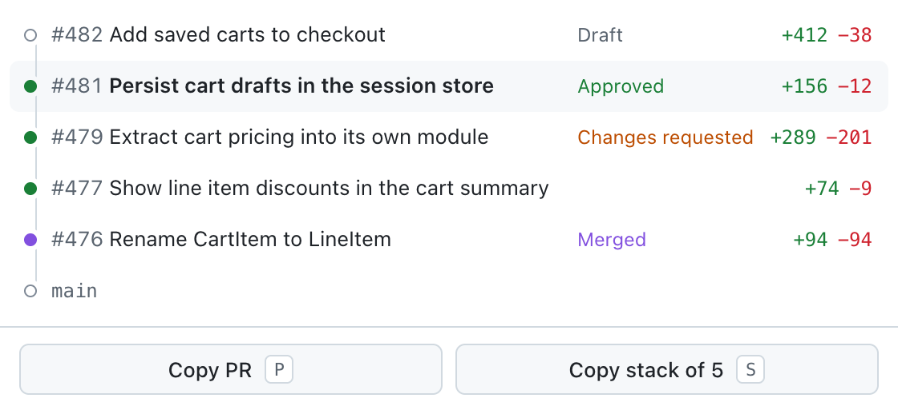
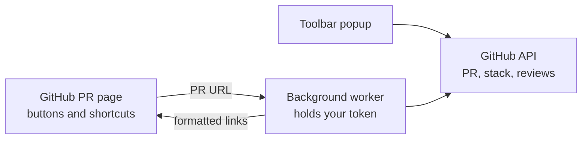

<div align="center">


# Stackslop

**Graphite-style PR links for plain GitHub.**

Copy a pull request, or its whole stack, with titles, diff stats, and review states,<br>
ready to paste into Slack.


[Install](#install) · [Usage](#usage) · [Shortcuts](#keyboard-shortcuts) · [Linear Reviews](#linear-reviews) · [Troubleshooting](#troubleshooting)

<br>



</div>

## Why

We moved from Graphite to GitHub's stacked pull requests and missed one small thing:
Graphite copies a PR as `#4377 Require both pages of passports +352/-54`, while GitHub gives
you a bare URL. Reviewers see what a PR is and how big it is before they click.

Stackslop brings that link back to GitHub, and copies whole stacks the same way.

## Features

- **Rich links.** The `#481 Title` part is a link and the diff stat is inline code. Slack,
  Notion, and Linear keep the formatting. Plain-text targets get Markdown.
- **Whole stacks.** Top of the stack first, each PR marked ● ready, ○ draft, ✓ merged, or
  ✕ closed, with *approved* or *changes requested* from its reviews, ending with the trunk
  branch.
- **Buttons where you already look.** **Copy link** and **Copy stack** sit in the PR header
  and next to the merge button.
- **Graphite's shortcuts.** <kbd>C</kbd> then <kbd>P</kbd>, <kbd>S</kbd>, <kbd>L</kbd>,
  <kbd>G</kbd>, <kbd>T</kbd>, <kbd>B</kbd>, or <kbd>C</kbd>, as in Graphite.
- **Linear Reviews links**, if your team reviews in Linear.
- **Nothing to build, nothing to trust.** Plain JavaScript, no dependencies, no analytics.
  It only talks to `api.github.com`, with your token, from your browser.

## Install

Stackslop isn't on the Chrome Web Store, so you load it from a clone. It takes about a
minute.

**1. Clone it, and copy your GitHub token**

```sh
gh repo clone olivercederborg/stackslop ~/Developer/stackslop
gh auth token | pbcopy
```

**2. Load it in your browser**

Open `chrome://extensions` (in Arc, `arc://extensions`), turn on **Developer mode**, click
**Load unpacked**, and pick the folder you cloned.

**3. Paste the token**

The options page opens on its own. Paste the token, and pick whether links point to GitHub
or Linear Reviews. Settings save as you go.

**4. Pin it**

In Chrome, pin Stackslop from the puzzle-piece menu, so the popup is one click away.

> [!TIP]
> Public repos work without a token. Private repos, and the review states, need one.

### Updating

```sh
git -C ~/Developer/stackslop pull
```

Then click ↻ on Stackslop's card in `chrome://extensions`. Your settings stay.

## Usage

### On a pull request page

Click **Copy link** or **Copy stack** in the PR header, or next to the merge button. The
icon turns into a check when it's copied. **Copy stack** only shows when the PR is in a
stack.

### Keyboard shortcuts

On any pull request page, press <kbd>C</kbd>, then within a second and a half:

| Keys | Copies | Example |
| --- | --- | --- |
| <kbd>C</kbd> <kbd>P</kbd> | The PR, as a rich link | #481 Persist cart drafts… `+156/-12` |
| <kbd>C</kbd> <kbd>S</kbd> | The whole stack | See the Slack screenshot above |
| <kbd>C</kbd> <kbd>L</kbd> | The plain link, to GitHub or Linear Reviews | `https://github.com/acme/shop/pull/481` |
| <kbd>C</kbd> <kbd>G</kbd> | The plain GitHub link, always | `https://github.com/acme/shop/pull/481` |
| <kbd>C</kbd> <kbd>T</kbd> | The title | `Persist cart drafts in the session store` |
| <kbd>C</kbd> <kbd>B</kbd> | The branch name | `cart-drafts` |
| <kbd>C</kbd> <kbd>C</kbd> | A checkout command | `gh stack checkout https://github.com/acme/shop/pull/481` |

A toast confirms what was copied. Shortcuts stay quiet while you type in a comment box, and
GitHub's own <kbd>C</kbd> shortcut on the Files tab still works.

The checkout command uses `gh stack checkout`, which sets up the whole stack, for stacked
PRs. Outside a stack, it's `gh pr checkout 481`.

### The popup

Click the toolbar icon, or press <kbd>⌥</kbd><kbd>⇧</kbd><kbd>C</kbd>, to preview the
stack before copying. <kbd>P</kbd> copies the PR and <kbd>S</kbd> the stack.

<p align="center">
  <picture>
    <source media="(prefers-color-scheme: dark)" srcset="docs/popup-dark.png">
    
  </picture>
</p>

### What lands on your clipboard

Each copy carries two formats, and the app you paste into picks one.

- **Rich text** for Slack, Notion, Linear, Google Docs, and email: a linked `#481 Title`,
  then the diff stat as inline code.
- **Markdown** for terminals, editors, and GitHub comments:

```md
○ [#482 Add saved carts to checkout](https://github.com/acme/shop/pull/482) `+412/-38` _draft_
● [#481 Persist cart drafts in the session store](https://github.com/acme/shop/pull/481) `+156/-12` _approved_
● [#479 Extract cart pricing into its own module](https://github.com/acme/shop/pull/479) `+289/-201` _changes requested_
● [#477 Show line item discounts in the cart summary](https://github.com/acme/shop/pull/477) `+74/-9`
✓ [#476 Rename CartItem to LineItem](https://github.com/acme/shop/pull/476) `+94/-94` _merged_
└ `main`
```

## Linear Reviews

If your team reviews in Linear, set **Links point to** to **Linear Reviews** in the
options. Copy link, Copy stack, the popup, and <kbd>C</kbd> then <kbd>P</kbd>,
<kbd>S</kbd>, or <kbd>L</kbd> then link to each PR's Linear review.

The links come from the "Review in Linear" comment Linear's bot leaves on linked PRs. A PR
without that comment keeps its GitHub link, and <kbd>C</kbd> <kbd>G</kbd> always copies
the GitHub link.

## How it works



- A **content script** on `github.com` adds the buttons and listens for the shortcuts.
- A **background worker** fetches the PR, its stack, and its reviews, then formats the
  links. Your token stays there and never reaches the GitHub page.
- Stacks come from GitHub's stacks API, the one `gh stack` uses. Review decisions and
  Linear links for the whole stack come from a single GraphQL query.
- Results are cached for a minute per PR, and changing a setting clears the cache.

### Permissions

| Permission | Why |
| --- | --- |
| `storage` | Your token and link setting, stored only in this browser |
| `clipboardWrite` | Copying from the popup |
| `activeTab` | The popup reads which PR you're looking at |
| `api.github.com` | Fetching PRs, stacks, and reviews |
| Content script on `github.com` | The buttons and shortcuts on PR pages |

## Troubleshooting

<details>
<summary><b>"GitHub couldn't find this PR"</b></summary>

GitHub answers "Not Found" for private repos it doesn't think you can see. Add a token in
the options. If your organization uses SAML single sign-on, the token also needs SSO
authorization. Tokens from `gh auth token` usually have it already.

</details>

<details>
<summary><b>There's no Copy stack button</b></summary>

The PR isn't in a GitHub stack. Stackslop reads GitHub's stacked pull requests, as
created with `gh stack`. It doesn't detect stacks that exist only in Graphite or another
tool.

</details>

<details>
<summary><b>The buttons disappeared</b></summary>

GitHub changes its page structure now and then. The shortcuts and the popup don't depend
on it, so they keep working. Open an issue with a screenshot, and the buttons will get new
anchors.

</details>

<details>
<summary><b>Slack pasted plain text, or a bare URL</b></summary>

Some apps, and Slack's plain-text paste (<kbd>⌘</kbd><kbd>⇧</kbd><kbd>V</kbd>), only take
plain text, so you get the Markdown version. <kbd>C</kbd> <kbd>L</kbd> and
<kbd>C</kbd> <kbd>G</kbd> copy bare URLs on purpose, so Slack unfurls them.

</details>

<details>
<summary><b>A Linear setting still copies GitHub links</b></summary>

That PR has no "Review in Linear" comment, usually because it isn't linked to a Linear
issue. Link it, and the next copy picks up the review link.

</details>

## Development

There's no build step. Edit a file, then click ↻ on the extension's card.

```
stackslop/
├── manifest.json     Manifest V3: permissions, popup, shortcut
├── icons/            icon.svg is the source; the PNGs are exported from it
├── docs/             README screenshots, made with demo data
└── src/
    ├── background.js Fetches and formats links for the page
    ├── content.js    Buttons, shortcuts, and toasts on github.com
    ├── github.js     GitHub REST and GraphQL calls
    ├── format.js     Rich-text and Markdown output
    ├── popup.*       Toolbar popup
    └── options.*     Token, link target, shortcut list
```

Chrome gives extension pages a built-in style that shrinks body text to 75%, so the base
font is set on `body`, not `:root`.

## Credits

Inspired by Graphite's copy link, which we missed the day we left. Built with
high-quality slop.
